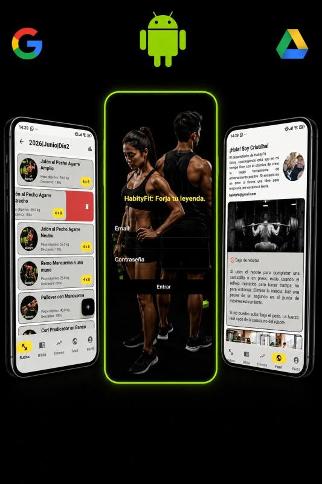
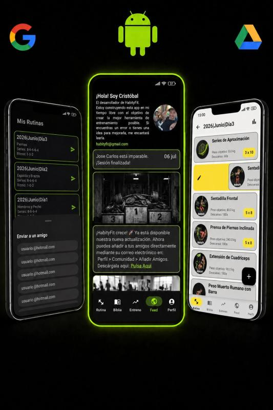

# HabityFit Android

Native Android client for **HabityFit**, an offline-first strength training platform. Users log workouts without connectivity; changes are stored locally and synchronized later with the [HabityFit API](https://github.com/BudzowskiPiotrek/habityfit-api-dotnet).


---

## Screenshots

| Home · Login · Feed | Routines · Feed · Workout |
|---|---|
|  |  |

---

## Features

| Area | Description |
|---|---|
| Routines | Create, edit and share routines with friends |
| Workout tracking | Sessions, sets, reps, weight, RPE and rest timer |
| Exercise library | Searchable catalog with GIF demos and an interactive SVG body map to filter by muscle |
| Progress | Custom Canvas charts: estimated 1RM, volume and max weight per session |
| Report | Weekly, monthly, 3-month and yearly stats, plus sets per muscle group vs. recommended range |
| 1RM calculator | Brzycki formula |
| Body composition | Weight, muscle, fat, water; derived fat % and BMR |
| Social | Friend requests, email invitations, routine requests and activity feed |

---

## Architecture

```text
:app            Compose UI, navigation, ViewModels and per-feature data/domain layers
:core:data      Shared models, mappers and the synchronization repository
:core:database  Room entities, DAOs, converters and AppDatabase
:core:network   Retrofit, Moshi, OkHttp, DTOs, interceptors and JWT/session management
```

- Feature-oriented clean architecture: each feature keeps its `data` / `domain` / `presentation` layers
- MVVM with `StateFlow` and Compose state
- Dependency injection with Hilt (KSP)
- Room as single source of truth; the UI observes `Flow`
- Multi-module Gradle project: `:app`, `:core:data`, `:core:database`, `:core:network`

---

## Offline-first Synchronization

```text
UI → Room (SyncStatus = PENDING) → Push → API
UI ← Room (SyncStatus = SYNCED)  ← Pull ← API (delta since LAST_SYNC)
```

- Every synchronized entity carries `CREATED_AT`, `UPDATED_AT`, `DELETED_AT` and `SYNC_STATUS`
- Soft delete so deletions propagate across devices
- Push sends only `PENDING` rows and marks as `SYNCED` the ones the server confirms
- Pull requests only entities changed since the last sync anchor
- JWT stored locally and refreshed during sync

---

## Tech Stack

Kotlin 2.0.20 • Jetpack Compose • Material 3 • Navigation Compose • Room 2.6.1 • Hilt 2.51.1 (KSP) • Retrofit 2.11.0 • Moshi 1.15.0 • OkHttp 4.12.0 • Coil 2.7.0 (GIF) • Coroutines / Flow

---

## Requirements

- JDK 17
- Android SDK Platform 35 (`compileSdk = 35`, `targetSdk = 35`, `minSdk = 24`)
- Android Studio
- Gradle 8.13 (provided by the Gradle wrapper)

---

## Build

`local.properties` is not versioned. Android Studio usually creates it with `sdk.dir`; add the remaining keys at the repository root:

```properties
# Android SDK location (usually generated by Android Studio)
sdk.dir=/path/to/Android/Sdk

# :core:network
BASE_URL=https://your-api-host/

# :app
TOKEN_APP=
LINK_APK=
EMAIL_APP=
```

| Key | Module | Used for |
|---|---|---|
| `BASE_URL` | `:core:network` | Retrofit base URL |
| `TOKEN_APP` | `:app` | App token exposed through `BuildConfig` |
| `LINK_APK` | `:app` | Download/update link shown by the update-required screen |
| `EMAIL_APP` | `:app` | Contact address used by the feed header |

The Gradle build reads these properties with empty defaults, so the project can compile without them. Network calls and the screens above need valid values at runtime.

Build the debug APK:

```bash
./gradlew assembleDebug
```

Install it on a connected device or emulator:

```bash
./gradlew installDebug
```

Release builds enable R8 minification and resource shrinking. Add your own signing configuration before distributing a release build.

---

## Tests

```bash
./gradlew testDebugUnitTest
./gradlew connectedDebugAndroidTest
```

The repository currently contains no unit or instrumentation test sources. The standard Gradle tasks are available for tests added later.

---

## Contributing

Contributions are welcome. For substantial changes, please open an issue first to discuss the approach. Fork the repository, create a focused branch, and open a pull request describing the change and how you tested it.

---

## License

This project is licensed under the Apache License 2.0. See [LICENSE](LICENSE) for the full text.

```
Copyright 2026 Piotrek Budzowski

Licensed under the Apache License, Version 2.0 (the "License");
you may not use this file except in compliance with the License.
You may obtain a copy of the License at

    http://www.apache.org/licenses/LICENSE-2.0

Unless required by applicable law or agreed to in writing, software
distributed under the License is distributed on an "AS IS" BASIS,
WITHOUT WARRANTIES OR CONDITIONS OF ANY KIND, either express or implied.
See the License for the specific language governing permissions and
limitations under the License.
```
